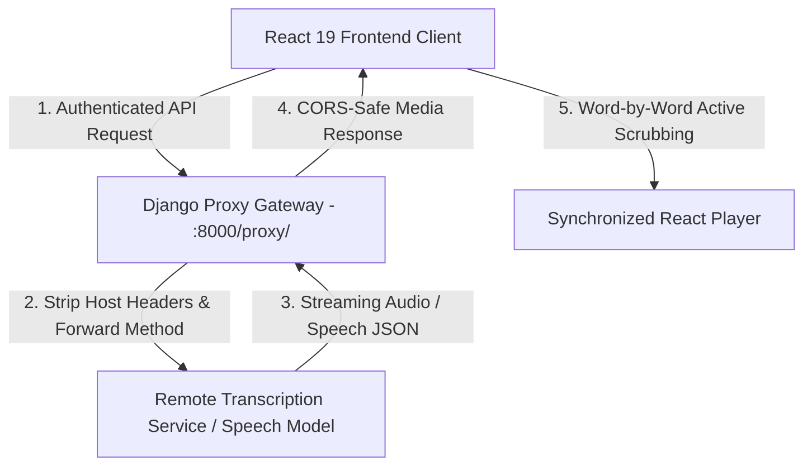

# TranscribeFlow — Audio/Video Transcription & Synchronized Playback Platform

## Verification scope

The frontend tests include a copied time-formatting function rather than importing the production implementation. They do not establish recording, transcription or complete session correctness.

[](https://react.dev/)
[](https://www.djangoproject.com/)
[](https://mui.com/)
[](https://ant.design/)
[](https://vitejs.dev/)

A media review prototype combining a **React 19** frontend with a **Django Reverse Proxy Gateway** to stream, scrub, and inspect timestamp-synchronized audio and video transcriptions. Designed for automated speech-to-text review, the platform features word-level timeline synchronization, automatic JWT expiration detection with silent token renewal, and CORS-isolated proxy streaming.

---

## Architectural Blueprint

The platform decouples client playback state from upstream speech transcription services via a Django proxy gateway; throughput has not been benchmarked:



---

## Core Capabilities

### 1. Timestamp-Synchronized Media Player
- **Interactive Word Scrubbing:** Clicking any transcribed phrase automatically seeks the embedded audio/video player (`react-player`) to the exact millisecond offset.
- **Dynamic Playback State:** Tracks duration, buffered percentages, playback speed adjustments, and current time markers.

### 2. Django Reverse Proxy Gateway
- **CORS & Origin Isolation:** Relays browser requests safely through `proxy_view`, preventing browser cross-origin policy blocks when communicating with external speech processing clusters.
- **Full Method Passthrough:** Forwards `GET`, `POST`, `PUT`, and `DELETE` transactions transparently while sanitizing host headers.
- **Configurable Service Discovery:** Service endpoint is decoupled to `REMOTE_TRANSCRIPTION_API` with local fallback.

### 3. Proactive JWT Session Renewal
- The client interceptor (`useApi.js`) inspects the decoded JWT `exp` timestamp *before* making outgoing calls.
- If a token is within its expiration window, it transparently queues the request, exchanges the refresh token for a new access token, and fulfills the pending operation with zero user interruption.

---

## Repository Structure

```
transcriptions-website/
├── proxy/                            # Django reverse proxy gateway
│   ├── manage.py
│   ├── .env.example
│   └── proxy/
│       ├── settings.py
│       ├── urls.py                   # Reverse proxy routing logic
│       └── tests.py                  # Proxy forwarding unit tests
└── main-app/                         # React 19 single-page application
    ├── .env.example
    ├── package.json
    ├── vite.config.js
    ├── tests/
    │   └── transcription_pipeline.test.js # Timestamp & auth tests
    └── src/
        ├── hooks/
        │   ├── useApi.js             # Axios interceptor with silent JWT refresh
        │   └── useAuth.js            # Authentication state hook
        ├── pages/
        │   ├── dashboard/            # Transcription catalog & upload
        │   ├── transcription/        # Interactive player & detailed logs
        │   └── auth/                 # Sign-in & account creation
        └── assets/                   # Sample video feeds & fixture speech data
```

---

## Quickstart & Local Setup

### 1. Prerequisites
- Python 3.10+
- Node.js 18+ and npm

### 2. Backend Proxy Gateway Setup

```bash
# Navigate to proxy directory
cd proxy

# Initialize and activate virtual environment
python -m venv .venv
source .venv/bin/activate  # On Windows: .venv\Scripts\activate

# Install dependencies
pip install django requests django-cors-headers

# Setup environment template
cp .env.example .env

# Run automated proxy tests
python manage.py test

# Start proxy gateway server
python manage.py runserver 8000
```

### 3. Frontend Client Setup

```bash
# Navigate to frontend directory
cd ../main-app

# Install dependencies
npm install

# Setup environment template
cp .env.example .env

# Run automated tests
npm test

# Launch Vite development server
npm run dev
```

Visit `http://localhost:5173` to explore the transcription interface.

---

## Automated Test Suites

### Backend Proxy Gateway Tests (Django)

```bash
cd proxy
python manage.py test
```
```
Creating test database for alias 'default'...
Found 3 test(s).
System check identified no issues (0 silenced).
...
----------------------------------------------------------------------
Ran 3 tests in 0.003s

OK
Destroying test database for alias 'default'...
```

### Frontend Pipeline & Sync Tests (Node Test Runner)

```bash
cd main-app
npm test
```
```
▶ Transcription Platform - Pipeline & Sync Mathematics
  ✔ Time formatter formats seconds into mm:ss and hh:mm:ss timestamps
  ✔ JWT expiration evaluator accurately identifies stale credentials
  ✔ Transcription record filtering filters by status and query term
✔ Transcription Platform - Pipeline & Sync Mathematics
ℹ tests 3
ℹ pass 3
ℹ fail 0
```

---

## License

No repository license has been specified. Third-party dependencies, brands and assets retain their respective terms.

